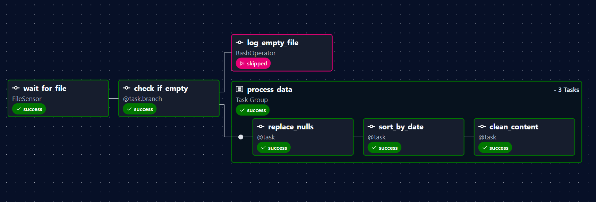
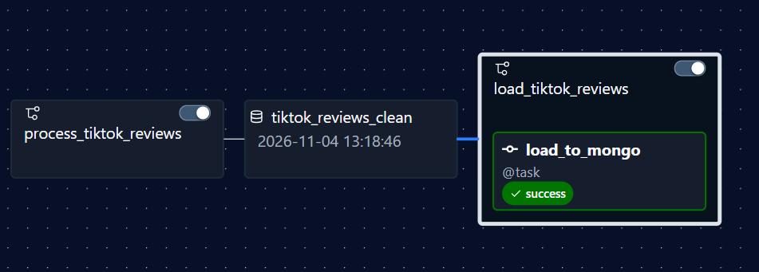

# Task 05 - Airflow

## Task description

Two Airflow DAGs that process TikTok Google Play reviews and load them into MongoDB.

1. **`process_tiktok_reviews`** - a `FileSensor` waits for the input CSV, a branch
   checks whether the file is empty, and a TaskGroup cleans the data:
   - `replace_nulls` - replaces all empty values with `-`;
   - `sort_by_date` - sorts reviews by creation date;
   - `clean_content` - removes everything except letters, digits, whitespace and
     punctuation from the `content` column.

   If the file is empty, a `BashOperator` logs it instead. The last task updates
   the `tiktok_reviews_clean` Asset.
2. **`load_tiktok_reviews`** - scheduled on the `tiktok_reviews_clean` Asset
   (data-aware scheduling), loads the processed file into the
   `tiktok.reviews` MongoDB collection.

Airflow 3.3 (LocalExecutor), its PostgreSQL metadata database and MongoDB run
locally in Docker.

## DAG screenshots





## Data decisions

- The task mentions a `created_date` column. The dataset has no such column -
  the review creation date is stored in `at`, so sorting and grouping use `at`.
- "Null" values are empty fields in the CSV; they are replaced with `-`.
- Reviews that consist only of emojis become empty after cleaning `content`;
  they are also replaced with `-`, so `-` consistently means "no content".
- The `-` placeholder is excluded from the content-based MongoDB queries
  (top comments and short comments), as it is not a real comment.

## Requirements

- Docker Desktop
- MongoDB Compass (to run the aggregation queries)

## Setup

1. Copy `.env.example` to `.env` and fill in the empty values
   (the file contains a command that generates passwords and keys).
2. Build the image and initialise Airflow:

   ```
   docker compose build
   docker compose up airflow-init
   docker compose up -d
   ```

3. Open Airflow at http://localhost:8080 and log in with the admin account from `.env`.
4. Create two connections in **Admin > Connections**:

   | Connection ID | Type | Settings |
   |---|---|---|
   | `fs_data` | File (path) | Path: `/opt/airflow/data` |
   | `mongo_tiktok` | MongoDB | Host: `mongo`, Port: `27017`, Login/Password: Mongo root account from `.env`, Extra: `{"srv": false, "ssl": false, "allow_insecure": false}` |

5. Unpause both DAGs, trigger `process_tiktok_reviews` and put
   `tiktok_google_play_reviews.csv` into the `data` folder.
   `load_tiktok_reviews` starts automatically after processing finishes.

## MongoDB queries

All queries are in [`mongo_queries.js`](mongo_queries.js) and were run in
MongoDB Compass (`tiktok` > `reviews` > Aggregations).

### 1. Top 5 most frequent comments

| Comment | Count |
|---|---|
| Good | 12167 |
| Nice | 10060 |
| Nice app | 4905 |
| Good app | 3662 |
| Great | 2288 |


### 2. Reviews with content shorter than 5 characters

44 642 reviews.

### 3. Average score for each day

79 days (2022-01-17 to 2022-04-05); the day is returned as a `Date`.
